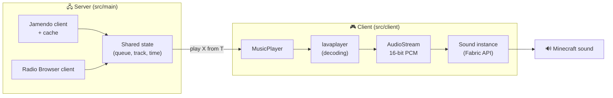

<div align="center">


# UnliMusic

**Music inside Minecraft: on your own, or in sync with every player in the world.**

[](https://github.com/afonsopadilha/UnliMusic/actions/workflows/build.yml)


[Features](#-features) · [Music sources](#-music-sources) · [How it works](#%EF%B8%8F-how-it-works) · [Roadmap](#%EF%B8%8F-roadmap) · [Building](#%EF%B8%8F-building-from-source)

</div>

---

> [!NOTE]
> UnliMusic is in early development and has no downloadable releases yet. This page describes what the mod **will** do; the [roadmap](#%EF%B8%8F-roadmap) shows what is already done.

## ✨ Features

- 🎧 **Personal mode**: listen to your own files, radio stations or Jamendo, just for you.
- 👥 **Shared mode**: the server picks the music and every player hears the same thing at the same time.
- 📻 **Radio stations from around the world**: search by name or country through Radio Browser.
- 🎼 **Free music from Jamendo**: thousands of Creative Commons tracks, with artist and license always shown.
- 📁 **Local files**: pick a folder and the mod reads title, artist and cover art from the tags.
- 🎚️ **Built-in volume control**: follows the game's *Jukebox/Note Blocks* sound slider.
- 🖥️ **"Now playing" HUD**, a search screen and a shared queue.
- 🔊 **Positional jukebox-style sound** *(optional, planned)*.

## 🎵 Music sources

Only legal, free sources, with no accounts or Premium subscriptions needed by players.

| Source | What it is | Personal | Shared |
|---|---|:---:|:---:|
| 📁 **Local files** | Music on your computer | ✅ | ❌ ¹ |
| 🎼 **[Jamendo](https://www.jamendo.com/)** | Creative Commons music (API v3.0) | ✅ | ✅ |
| 📻 **[Radio Browser](https://www.radio-browser.info/)** | Open directory of online radio stations | ✅ | ✅ |

¹ Local files only exist on the computer of whoever owns them, so they can't be shared (for now).

> [!IMPORTANT]
> UnliMusic does **not** support YouTube, Spotify, Deezer or any other commercial service, and never will. Extracting audio from those services breaks their terms of service.

## 🧩 Modes

| | 🎧 Personal | 👥 Shared |
|---|---|---|
| **Who hears it** | Only you | Every player in the world |
| **Who's in control** | Your client | The server (`/music`) |
| **Mod needed on the server** | No | Yes, and on every client |
| **Radio** | You tune in | Everyone tunes in to the same live stream |
| **Jamendo** | You play it | The server sends "track X from time T" and each client seeks to it |

## ⚙️ How it works



- **[lavaplayer](https://github.com/lavalink-devs/lavaplayer)** decodes the audio to PCM (only the HTTP and local sources are registered).
- The PCM feeds a custom `AudioStream`, played by a Fabric API sound instance, so it respects the game's volume settings.
- Networking, decoding and API requests always run off the game thread: music never causes lag.
- Jamendo searches run on the server and are cached, to save the free API quota.

## 🗺️ Roadmap

The full plan, with one sheet per work session, lives in [`docs/plan/`](docs/plan/README.md).

| Phase | Goal | Entries | Status |
|---|---|---|:---:|
| 0 · Foundations | Clean project, lavaplayer bundled in the jar | E00–E01 | ⬜ |
| 1 · Listening alone | Play files and radio, pause, HUD | E02–E05 | ⬜ |
| 2 · Finding music | Radio search, Jamendo, networking, main screen | E06–E09 | ⬜ |
| 3 · Listening together | Shared mode, sync, permissions, queue | E10–E13 | ⬜ |
| 4 · Local files & settings | Local library, cover art, configuration | E14–E16 | ⬜ |
| 5 · Extras | Positional jukebox-style sound | E17 | ⬜ |
| 6 · Release | Multiplayer testing, polish, publishing | E18–E20 | ⬜ |

<sub>✅ done · ⏳ in progress · ⬜ to do</sub>

## 🛠️ Building from source

**Requirements:** JDK 25. Gradle is included (wrapper).

```bash
git clone https://github.com/afonsopadilha/UnliMusic.git
cd UnliMusic
./gradlew runClient   # launches Minecraft with the mod
./gradlew build       # builds the jar into build/libs/
```

On Windows, use `gradlew.bat` instead of `./gradlew`. To set up your IDE, see the [Fabric documentation](https://docs.fabricmc.net/develop/getting-started/creating-a-project#setting-up).

### Jamendo client ID

Jamendo support needs a free client ID, created on the [Jamendo developer portal](https://devportal.jamendo.com/). It goes in a server config file that is **never** committed to Git. Without it the mod still works, just without Jamendo.

## 📜 Credits and license

- Jamendo music: each track has its own Creative Commons license, and the mod always shows the artist and license. Non-commercial use.
- Radio stations: directory by [Radio Browser](https://www.radio-browser.info/); streams belong to their respective stations.
- Audio decoding: [lavaplayer](https://github.com/lavalink-devs/lavaplayer).
- Built with [Fabric](https://fabricmc.net/).

The mod's code is licensed under [CC0 1.0](LICENSE).

<div align="center">
<sub>UnliMusic is not affiliated with Mojang or Microsoft.</sub>
</div>
