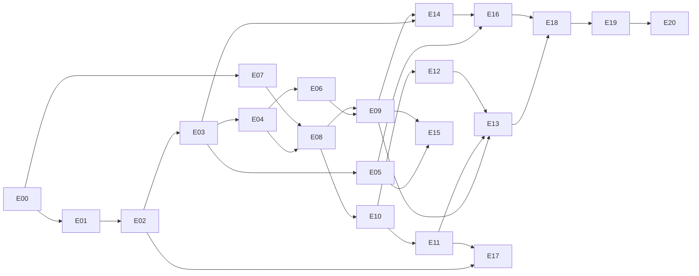

# UnliMusic plan

This plan splits the mod into **21 entries** (E00 to E20). Each entry is one work session (the bigger ones may need two) and always has the same structure:

| Section | What it's for |
|---|---|
| **In a nutshell** | What it is, without jargon. |
| **What you'll see at the end** | What changes in the game once the entry is done. |
| **What gets built** | The technical pieces. |
| **New concepts** | What you'll learn (you're new to modding, so this matters). |
| **Suggested steps** | Small ones, each testable with `./gradlew runClient`. |
| **Done when** | Checklist for calling the entry finished. |
| **Pitfalls** | Where it's easy to go wrong. |
| **APIs** | What has already been confirmed in the 26.3 sources and what the session must confirm before writing code. |
| **Session kickoff prompt** | Text to paste into a new session. |
| **Session notes** | Filled in at the end of each session: decisions made and what was left to do. |

## How to use it

1. Check the roadmap in `CLAUDE.md` for the next entry whose dependencies are already done.
2. Open a new session and paste that entry's **Session kickoff prompt**.
3. The session confirms the APIs, moves forward in small steps and tests in the game.
4. At the end: fill in the entry's **Session notes** and tick `[x]` in `CLAUDE.md`.

## Project status (26 Oct 2026)

- Official Fabric template, no features yet (only the example mixins).
- **Minecraft 26.3**, Fabric Loader 0.19.5, Fabric API 0.162.0+26.3, Java 25. `runClient` has already launched (log from 7 Oct).
- Mod ID `unlimusic`, package `com.unlimusic`, code split into `src/main` and `src/client` (`splitEnvironmentSourceSets`).
- APIs already confirmed in the Fabric API 26.3 sources (in the Gradle cache):
  - `FabricSoundInstance.getAudioStream(SoundBufferLibrary, Identifier, boolean)` and `FabricSoundInstance.EMPTY_SOUND`
  - `KeyMappingHelper.registerKeyMapping(KeyMapping)`
  - `HudElementRegistry` (the HUD is drawn with `extractRenderState(GuiGraphicsExtractor, DeltaTracker)`)
  - `PayloadTypeRegistry.serverboundPlay()` / `clientboundPlay()`, `ServerPlayNetworking`, `ClientPlayNetworking`, `PlayerLookup`
  - `CommandRegistrationCallback` (server) and `ClientCommandRegistrationCallback` (client)
  - In Minecraft: `AudioStream` (`getFormat()`, `read(int)`, `close()`), `SoundSource.RECORDS`, `AbstractSoundInstance`
- lavaplayer: the latest version on Maven Central is **2.2.7**.

## The architecture in one minute

```
                       ┌──────────────────── CLIENT (src/client) ─────────────────────┐
 keys, screen, HUD ──► │ MusicPlayer ──► MusicSource ──► lavaplayer ──► PCM            │
                       │ (state)        (Local/Radio/   (decodes)        │             │
                       │                 Jamendo)                        ▼             │
                       │                         PcmAudioStream ──► MusicSoundInstance │──► Minecraft sound
                       └──────────────────────────────▲────────────────────────────────┘    (Jukebox slider)
                                 "play X from time T" │    Jamendo searches
                                       packets        │    and results
                       ┌──────────────────── SERVER (src/main) ───────────────────────┐
 /music ─────────────► │ SharedMusicState (queue, track, time)      JamendoClient+cache│──► api.jamendo.com
                       │ validates radios by UUID ─────────────────► RadioBrowserClient│──► radio-browser.info
                       └───────────────────────────────────────────────────────────────┘
```

- **`src/main`** runs on both sides (including a dedicated server): packets, shared state, commands, API clients, configuration.
- **`src/client`** only runs in the player's game: audio (lavaplayer), HUD, screens, keys. lavaplayer is **never** loaded on the server.

## Entry map

| ID | Entry | Phase | Depends on | Difficulty | Old roadmap |
|---|---|---|---|---|---|
| [E00](E00-project-setup.md) | Clean up the project and first key | 0 Foundations | — | ●○○○○ | step 0 |
| [E01](E01-lavaplayer-in-jar.md) | Bundle lavaplayer inside the jar | 0 Foundations | E00 | ●●●○○ | — |
| [E02](E02-play-local-file.md) | Play a fixed local file (the pipeline) | 1 Listening alone | E01 | ●●●●○ | step 1 |
| [E03](E03-playback-engine.md) | Playback engine: pause, stop, end of track | 1 Listening alone | E02 | ●●●○○ | step 3 (keys) |
| [E04](E04-play-radio-url.md) | Play a radio station from a fixed URL | 1 Listening alone | E03 | ●●○○○ | step 2 |
| [E05](E05-now-playing-hud.md) | "Now playing" HUD | 1 Listening alone | E03 | ●●●○○ | step 3 (HUD) |
| [E06](E06-radio-search.md) | Radio search (Radio Browser) | 2 Finding music | E04 | ●●○○○ | step 4 |
| [E07](E07-jamendo-client.md) | Server-side Jamendo client, with cache | 2 Finding music | E00 | ●●●○○ | step 4 |
| [E08](E08-networking-packets.md) | Networking: client ↔ server packets | 2 Finding music | E04, E07 | ●●●○○ | step 5 |
| [E09](E09-main-screen.md) | Main screen: radios and Jamendo | 2 Finding music | E06, E08 | ●●●●○ | step 4 |
| [E10](E10-shared-mode-server.md) | Shared mode: server state and `/music` | 3 Listening together | E08 | ●●●●○ | step 5 |
| [E11](E11-synchronization.md) | Synchronization on the clients | 3 Listening together | E10 | ●●●●○ | step 5 |
| [E12](E12-permissions-security.md) | Permissions, security and limits | 3 Listening together | E10 | ●●●○○ | step 5 |
| [E13](E13-shared-queue-screen.md) | Shared queue on screen | 3 Listening together | E09, E11, E12 | ●●●○○ | step 5 |
| [E14](E14-local-files.md) | Local file library | 4 Local files & settings | E03, E09 | ●●●○○ | step 6 |
| [E15](E15-cover-art.md) | Cover art and images *(optional)* | 4 Local files & settings | E05, E09 | ●●●○○ | — |
| [E16](E16-settings.md) | Settings and configuration | 4 Local files & settings | E05, E14 | ●●○○○ | step 6 |
| [E17](E17-positional-sound.md) | Positional jukebox-style sound *(optional)* | 5 Extras | E02, E11 | ●●●●○ | — |
| [E18](E18-multiplayer-testing.md) | Real testing: multiplayer, server, other OSes | 6 Release | whatever is being released | ●●○○○ | — |
| [E19](E19-polish.md) | Polish: translations, messages, errors | 6 Release | E18 | ●●○○○ | — |
| [E20](E20-publishing.md) | Publishing | 6 Release | E19 | ●●○○○ | — |



E07 (Jamendo) doesn't need audio to be done: it can be done in parallel with Phase 1 if you feel like a change.

## Open decisions

Each one is made in the entry listed; the recommendation is only a starting point.

| # | Decision | Where | Recommendation |
|---|---|---|---|
| D1 | `CLAUDE.md` says Minecraft 26.1.x, but the project is on **26.3** | E00 | **Decided in E00: 26.3.** `CLAUDE.md` fixed to match `gradle.properties` |
| D2 | Whose Jamendo client ID goes into a public release? An ID embedded in the jar is exposed, and the quota (~35,000/month) is shared by every player in the world | E07, E20 | For now: your ID in a file outside Git. Before publishing: each server owner sets their own; without an ID, the Jamendo tab is disabled with instructions. Backed by the API terms (clause 2: the ID is personal and must not be shared) |
| D3 | Who can control the shared music? | E12 | OP by default, configurable |
| D4 | Scope of shared mode: whole server, dimension or area? | E10 | Whole server first |
| D5 | Personal and shared music at the same time? | E11 | Shared music pauses personal music; each player can leave shared mode |
| D6 | Pause decoding, or stop the sound and recreate it on resume? | E03 | **Decided in E03: pause the OpenAL channel in place.** Reopening with a seek rolled back seconds on VBR MP3s (lavaplayer's Xing seek is coarse). A mixin on `SoundEngine.resume()` keeps our channel paused when a screen closes. Radio will reopen live instead (E04) |
| D7 | Own settings screen or a library (Cloth Config, YACL)? | E16 | Own screen, so players don't have to install more mods |
| D8 | Tag library (e.g. jaudiotagger) for cover art and album of local files? | E14 | Start with only what lavaplayer provides |
| D9 | Jamendo on a server without the mod? | E08 | Not supported: Jamendo needs the mod on the server (or singleplayer) |
| D10 | The mod's license (the template came with CC0) | E20 | **Decided early, before making the repository public: MIT.** Same freedom as CC0, but copies must keep the copyright notice (credit); CC0 is not meant for software |
| D11 | The jar is 30.9 MB, 27 MB of it lavaplayer natives for 12 platforms (32-bit Windows/Linux, ARM boards, musl…) that Minecraft hardly runs on | E20 | Repack `lavaplayer-natives` keeping only Windows x64, Linux x64/aarch64 and macOS; decide after E18 shows which systems matter |
| D12 | PCM sample rate: the plan said 48 kHz, but lavaplayer's `COMMON_PCM_S16_LE` is 44.1 kHz | E02 | **Decided in E02: 44.1 kHz.** It is the rate of almost every MP3, Jamendo track and radio stream, so lavaplayer rarely resamples; OpenAL accepts any rate |
| D13 | Donations (GitHub Sponsors) or platform reward programmes (CurseForge)? The Jamendo API is non-commercial only, and its terms count "any monetary compensation" as commercial, without mentioning donations | E20 | Keep them off until `licensing@jamendo.com` confirms in writing that voluntary donations to a free mod are non-commercial. Never put Jamendo features behind a payment |
| D14 | How do players control the mod: chat commands or a clickable interface? | E05, E09, E13 | **Decided while planning: a clickable screen opened with a key is the main way.** The HUD only displays (the mouse is captured while playing), quick keys cover pause/stop, and `/music` commands stay for admins, the console and testing. The Jamendo link lives in the screen; the chat announcement is an option, off by default (E16) |
| D15 | What does a radio do when paused, and when its stream drops? | E04 | **Decided in E04: pausing stops the sound and connection, resuming tunes in again live** (also after more than 3 s in the pause menu). A drop reconnects after 1, 2, 4, 8, 16 s, then gives up with a chat message; only a station that has already played is retried |
| D16 | Radio Browser gives `url` and `url_resolved`: which one to play? | E06 | `url`: it may be a playlist or a redirect that picks a working server each time (lavaplayer follows both), while `url_resolved` pins one edge (in E04 one of RFM's delivered 0.67× real time). Skip HLS (`hls=1`): lavaplayer only reads MPEG-TS segments, and RTP's are packed AAC |

| D17 | What does the HUD show, and where does the rest of the feedback go? | E05 | **Decided in E05: the HUD shows only while a track loads, plays or is paused**, in the top-left corner (a position setting is left for E16), drawn under the chat and the player list and hidden by F1. The messages above the hotbar ("Playing…", "Paused") are gone; a failure hides the HUD and goes to chat, where it can be read |

## Ideas for later (outside the plan)

- Server-side music folder served to clients (already mentioned in `CLAUDE.md`).
- Voting to skip a track.
- Saved playlists and favourites.
- A custom "speaker" block, or hooking into the game's jukebox.
- Audio visualizer in the HUD.
- **Song on air for radios** (a fun extra, not needed for a release): when a station sends it, show the song it is playing right now (ICY `StreamTitle`, e.g. "Artist - Title") and make it easy to get at: on the HUD (E05) and in the screen (E09), e.g. to copy it or look it up. lavaplayer does not read it (found in E04): it needs the `Icy-MetaData: 1` request header and a stream that strips the metadata blocks (every `icy-metaint` bytes) out of the audio, so our own HTTP track. Not every station sends it.
- Our own HLS reader for packed-audio segments (`.aac`), so RTP's stations (Antena 1, 2, 3), which only offer HLS, can play (lavaplayer only reads MPEG-TS segments; found in E04).

## Glossary

- **Entrypoint**: the class Fabric calls on startup. `main` runs on client and server; `client` only in the player's game.
- **Mixin**: a way of changing Minecraft's code from the inside. Powerful but fragile; only used when the Fabric API isn't enough.
- **Accessor** (mixin): a mixin interface that reads a private field of a Minecraft class, e.g. the sound engine's channel map.
- **State machine**: a fixed set of states (stopped, playing, paused…) and the only transitions allowed between them.
- **Game / server / sound / network thread**: Minecraft does several things in parallel. Slow work goes off the game thread; touching the world or the screen only happens on it.
- **PCM**: "raw" sound, a list of numbers (samples). 16 bits, 44,100 samples per second, 2 channels = stereo.
- **Streaming**: playing a sound in chunks (about a second at a time) instead of loading it whole. The sound engine **pulls** the next chunk by calling our `AudioStream.read()` on its own thread.
- **Frame** (lavaplayer): 20 ms of decoded PCM (960 samples per channel). `PcmAudioStream` joins frames into the one-second chunks the engine asks for.
- **Little-endian**: the byte order of each sample. Minecraft's OpenAL wants little-endian.
- **`AudioStream`**: Minecraft interface that feeds PCM to the sound engine, in chunks.
- **`SoundInstance`**: "a sound that is playing" in Minecraft (position, volume, category).
- **`SoundSource`**: the volume category. `RECORDS` = the "Jukebox/Note Blocks" slider.
- **Source manager** (lavaplayer): the module that knows how to open one kind of source (local file, HTTP…).
- **Payload / packet**: a custom message between client and server. **C2S** = client→server, **S2C** = server→client.
- **Brigadier**: Minecraft's command system (`/music ...`).
- **HUD**: what is drawn on top of the game (health bar, hotbar… and our "now playing").
- **Screen**: a game screen/window (menu, inventory, our mod's screen).
- **`include` (Loom)**: puts a jar inside the mod's jar (jar-in-jar). It is not transitive.
- **Integrated server**: in singleplayer there is also a server, running inside your game. That's why commands and packets work when playing alone.
- **ICY / Shoutcast / Icecast**: how online radio streams work: a never-ending HTTP response, with the station's name in `icy-*` headers (and, if asked, the song on air mixed into the audio).
- **Prebuffer / rebuffer**: collecting a few seconds of audio before playing (or after running dry), so a stream that arrives in real time has slack for a slow network.
- **Exponential backoff**: waiting twice as long after each failed attempt (1 s, 2 s, 4 s…), so a server that is down is not hammered.
- **Render state extraction**: in 26.x the GUI is drawn in two phases. While "extracting", code like our HUD only lists what to draw (`GuiGraphicsExtractor` → `GuiRenderState`); the game draws the list afterwards. Something listed later that overlaps something earlier ends up on top of it.
- **GUI scale**: the "GUI Scale" video option. HUD coordinates are in GUI pixels; at scale 3 each one is 3×3 screen pixels.
- **Scissor**: a rectangle that cuts off anything drawn outside it, used to make long text scroll inside a window.
- **AAC / HE-AAC (AAC+)**: the other common radio codec besides MP3. HE-AAC adds a layer (SBR) that rebuilds the treble, for good sound at 48–64 kbps; stations send it in ADTS frames as `audio/aacp`.
