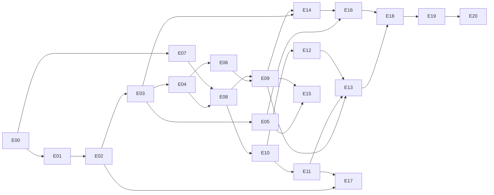

# Plano do UnliMusic

Este plano divide o mod em **21 entradas** (E00 a E20). Cada entrada é uma sessão de trabalho (as maiores podem precisar de duas) e tem sempre a mesma estrutura:

| Secção | Para que serve |
|---|---|
| **Em poucas palavras** | O que é, sem jargão. |
| **No fim vais ver** | O que muda no jogo quando a entrada fica feita. |
| **O que se constrói** | As peças técnicas. |
| **Conceitos novos** | O que vais aprender (és novo em modding, por isso isto conta). |
| **Passos sugeridos** | Pequenos, cada um testável com `./gradlew runClient`. |
| **Pronto quando** | Lista de verificação para dar a entrada por concluída. |
| **Armadilhas** | Onde é fácil errar. |
| **APIs** | O que já foi confirmado nas fontes da 26.3 e o que a sessão tem de confirmar antes de escrever código. |
| **Para começar a sessão** | Texto para colar numa sessão nova. |
| **Notas da sessão** | Preenchido no fim de cada sessão: decisões tomadas e o que ficou por fazer. |

## Como usar

1. Vê no roadmap do `CLAUDE.md` qual é a próxima entrada cujas dependências já estão feitas.
2. Abre uma sessão nova e cola o texto de **Para começar a sessão** dessa entrada.
3. A sessão confirma as APIs, avança em passos pequenos e testa no jogo.
4. No fim: preenche **Notas da sessão** na entrada e marca `[x]` no `CLAUDE.md`.

## Estado do projeto (26 out 2026)

- Template oficial do Fabric, ainda sem funcionalidades (só os mixins de exemplo).
- **Minecraft 26.3**, Fabric Loader 0.19.5, Fabric API 0.162.0+26.3, Java 25. O `runClient` já arrancou (log de 7 out).
- Mod ID `unlimusic`, pacote `com.unlimusic`, código separado em `src/main` e `src/client` (`splitEnvironmentSourceSets`).
- APIs já confirmadas nas fontes da Fabric API 26.3 (no cache do Gradle):
  - `FabricSoundInstance.getAudioStream(SoundBufferLibrary, Identifier, boolean)` e `FabricSoundInstance.EMPTY_SOUND`
  - `KeyMappingHelper.registerKeyMapping(KeyMapping)`
  - `HudElementRegistry` (o HUD desenha-se com `extractRenderState(GuiGraphicsExtractor, DeltaTracker)`)
  - `PayloadTypeRegistry.serverboundPlay()` / `clientboundPlay()`, `ServerPlayNetworking`, `ClientPlayNetworking`, `PlayerLookup`
  - `CommandRegistrationCallback` (servidor) e `ClientCommandRegistrationCallback` (cliente)
  - No Minecraft: `AudioStream` (`getFormat()`, `read(int)`, `close()`), `SoundSource.RECORDS`, `AbstractSoundInstance`
- lavaplayer: última versão no Maven Central é a **2.2.7**.

## A arquitetura num minuto

```
                       ┌──────────────────── CLIENTE (src/client) ────────────────────┐
 teclas, ecrã, HUD ──► │ MusicPlayer ──► MusicSource ──► lavaplayer ──► PCM            │
                       │ (estado)       (Local/Rádio/   (descodifica)    │             │
                       │                 Jamendo)                        ▼             │
                       │                         PcmAudioStream ──► MusicSoundInstance │──► som do Minecraft
                       └──────────────────────────────▲────────────────────────────────┘    (slider Jukebox)
                                pacotes "toca X a     │    pesquisas Jamendo
                                partir do instante T" │    e resultados
                       ┌──────────────────── SERVIDOR (src/main) ─────────────────────┐
 /music ─────────────► │ SharedMusicState (fila, faixa, instante)   JamendoClient+cache│──► api.jamendo.com
                       │ valida rádios por UUID ───────────────────► RadioBrowserClient│──► radio-browser.info
                       └───────────────────────────────────────────────────────────────┘
```

- **`src/main`** corre nos dois lados (incluindo servidor dedicado): pacotes, estado partilhado, comandos, clientes das APIs, configuração.
- **`src/client`** só corre no jogo do jogador: áudio (lavaplayer), HUD, ecrãs, teclas. A lavaplayer **nunca** é carregada no servidor.

## Mapa das entradas

| ID | Entrada | Fase | Depende de | Dificuldade | Roadmap antigo |
|---|---|---|---|---|---|
| [E00](E00-arrumar-projeto.md) | Arrumar o projeto e primeira tecla | 0 Fundações | — | ●○○○○ | passo 0 |
| [E01](E01-lavaplayer-no-jar.md) | Pôr a lavaplayer dentro do jar | 0 Fundações | E00 | ●●●○○ | — |
| [E02](E02-tocar-ficheiro-local.md) | Tocar um ficheiro local fixo (o pipeline) | 1 Ouvir sozinho | E01 | ●●●●○ | passo 1 |
| [E03](E03-motor-de-reproducao.md) | Motor de reprodução: pausar, parar, fim da faixa | 1 Ouvir sozinho | E02 | ●●●○○ | passo 3 (teclas) |
| [E04](E04-tocar-radio-url.md) | Tocar uma rádio a partir de um URL fixo | 1 Ouvir sozinho | E03 | ●●○○○ | passo 2 |
| [E05](E05-hud-a-tocar-agora.md) | HUD "a tocar agora" | 1 Ouvir sozinho | E03 | ●●●○○ | passo 3 (HUD) |
| [E06](E06-pesquisa-radios.md) | Pesquisa de rádios (Radio Browser) | 2 Encontrar música | E04 | ●●○○○ | passo 4 |
| [E07](E07-cliente-jamendo.md) | Cliente da Jamendo no servidor, com cache | 2 Encontrar música | E00 | ●●●○○ | passo 4 |
| [E08](E08-rede-pacotes.md) | Rede: pacotes cliente ↔ servidor | 2 Encontrar música | E04, E07 | ●●●○○ | passo 5 |
| [E09](E09-ecra-principal.md) | Ecrã principal: rádios e Jamendo | 2 Encontrar música | E06, E08 | ●●●●○ | passo 4 |
| [E10](E10-partilhado-servidor.md) | Modo partilhado: estado no servidor e `/music` | 3 Ouvir juntos | E08 | ●●●●○ | passo 5 |
| [E11](E11-sincronizacao.md) | Sincronização nos clientes | 3 Ouvir juntos | E10 | ●●●●○ | passo 5 |
| [E12](E12-permissoes-seguranca.md) | Permissões, segurança e limites | 3 Ouvir juntos | E10 | ●●●○○ | passo 5 |
| [E13](E13-fila-partilhada-ecra.md) | Fila partilhada no ecrã | 3 Ouvir juntos | E09, E11, E12 | ●●●○○ | passo 5 |
| [E14](E14-ficheiros-locais.md) | Biblioteca de ficheiros locais | 4 Locais e definições | E03, E09 | ●●●○○ | passo 6 |
| [E15](E15-capas-imagens.md) | Capas e imagens *(opcional)* | 4 Locais e definições | E05, E09 | ●●●○○ | — |
| [E16](E16-definicoes.md) | Definições e configuração | 4 Locais e definições | E05, E14 | ●●○○○ | passo 6 |
| [E17](E17-som-posicional.md) | Som posicional tipo jukebox *(opcional)* | 5 Extras | E02, E11 | ●●●●○ | — |
| [E18](E18-testes-multijogador.md) | Testes a sério: multijogador, servidor, outros SO | 6 Lançamento | o que se quer lançar | ●●○○○ | — |
| [E19](E19-polimento.md) | Polimento: traduções, mensagens, erros | 6 Lançamento | E18 | ●●○○○ | — |
| [E20](E20-publicar.md) | Publicar | 6 Lançamento | E19 | ●●○○○ | — |



A E07 (Jamendo) não precisa de áudio para ser feita: dá para a fazer em paralelo com a Fase 1, se te apetecer variar.

## Decisões em aberto

Cada uma é tomada na entrada indicada; a recomendação é só ponto de partida.

| # | Decisão | Onde | Recomendação |
|---|---|---|---|
| D1 | O `CLAUDE.md` diz Minecraft 26.1.x, mas o projeto está em **26.3** | E00 | Ficar na 26.3 (já arranca) e corrigir o `CLAUDE.md` |
| D2 | De quem é o client ID da Jamendo numa versão pública? Um ID embutido no jar fica exposto e a quota (~35 000/mês) é partilhada por todos os jogadores do mundo | E07, E20 | Agora: o teu ID num ficheiro fora do Git. Antes de publicar: cada dono de servidor põe o seu; sem ID, o separador Jamendo fica desativado com instruções |
| D3 | Quem pode controlar a música partilhada? | E12 | OP por defeito, configurável |
| D4 | Âmbito do modo partilhado: servidor inteiro, dimensão ou zona? | E10 | Servidor inteiro primeiro |
| D5 | Música pessoal e partilhada ao mesmo tempo? | E11 | A partilhada pausa a pessoal; cada jogador pode sair do partilhado |
| D6 | Pausar a descodificação ou parar o som e recriá-lo ao retomar? | E03 | Decidir na sessão, depois de testar |
| D7 | Ecrã de definições próprio ou biblioteca (Cloth Config, YACL)? | E16 | Próprio, para não obrigar a instalar mais mods |
| D8 | Biblioteca de tags (ex. jaudiotagger) para capas e álbum dos ficheiros locais? | E14 | Começar só com o que a lavaplayer dá |
| D9 | Jamendo num servidor que não tem o mod? | E08 | Não suportado: Jamendo precisa do mod no servidor (ou singleplayer) |
| D10 | Licença do mod (o template trouxe CC0) | E20 | Escolher conscientemente antes de publicar |

## Ideias para depois (fora do plano)

- Pasta de músicas no servidor servida aos clientes (já prevista no `CLAUDE.md`).
- Votação para saltar faixa.
- Playlists guardadas e favoritos.
- Bloco "coluna" próprio, ou ligar à jukebox do jogo.
- Visualizador de áudio no HUD.

## Glossário

- **Entrypoint**: a classe que o Fabric chama ao arrancar. `main` corre em cliente e servidor; `client` só no jogo do jogador.
- **Mixin**: forma de alterar código do Minecraft por dentro. Poderoso mas frágil; só se usa quando a Fabric API não chega.
- **Thread do jogo / do servidor / de som / de rede**: o Minecraft faz várias coisas em paralelo. Trabalho lento fora da thread do jogo; mexer no mundo ou no ecrã só dentro dela.
- **PCM**: som "cru", uma lista de números (amostras). 16 bits, 48 000 amostras por segundo, 2 canais = estéreo.
- **Little-endian**: a ordem dos bytes de cada amostra. O OpenAL do Minecraft quer little-endian.
- **`AudioStream`**: interface do Minecraft que entrega PCM ao motor de som, aos bocados.
- **`SoundInstance`**: "um som a tocar" no Minecraft (posição, volume, categoria).
- **`SoundSource`**: a categoria de volume. `RECORDS` = slider "Jukebox/Blocos de notas".
- **Source manager** (lavaplayer): o módulo que sabe abrir um tipo de origem (ficheiro local, HTTP…).
- **Payload / pacote**: mensagem própria entre cliente e servidor. **C2S** = cliente→servidor, **S2C** = servidor→cliente.
- **Brigadier**: o sistema de comandos do Minecraft (`/music ...`).
- **HUD**: o que se desenha por cima do jogo (barra de vida, hotbar… e o nosso "a tocar agora").
- **Screen**: um ecrã/janela do jogo (menu, inventário, o nosso ecrã do mod).
- **`include` (Loom)**: mete um jar dentro do jar do mod (jar-in-jar). Não é transitivo.
- **Servidor integrado**: em singleplayer também há um servidor, a correr dentro do teu jogo. Por isso os comandos e pacotes funcionam sozinho.
